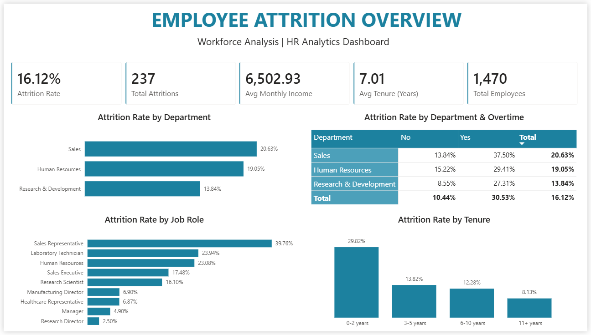
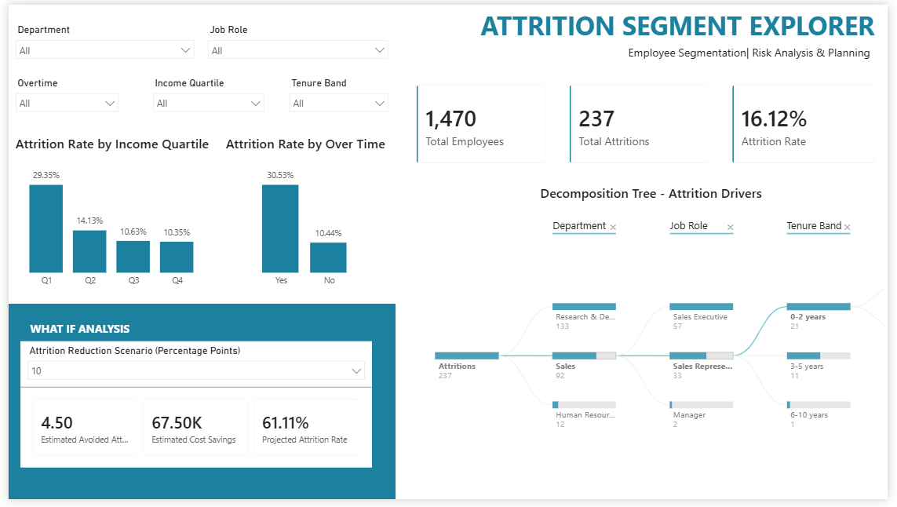
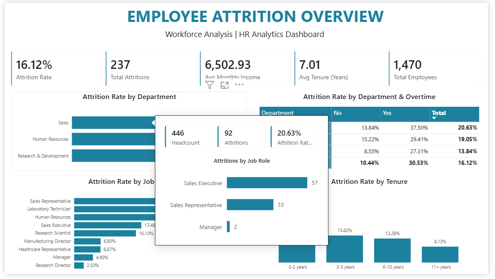
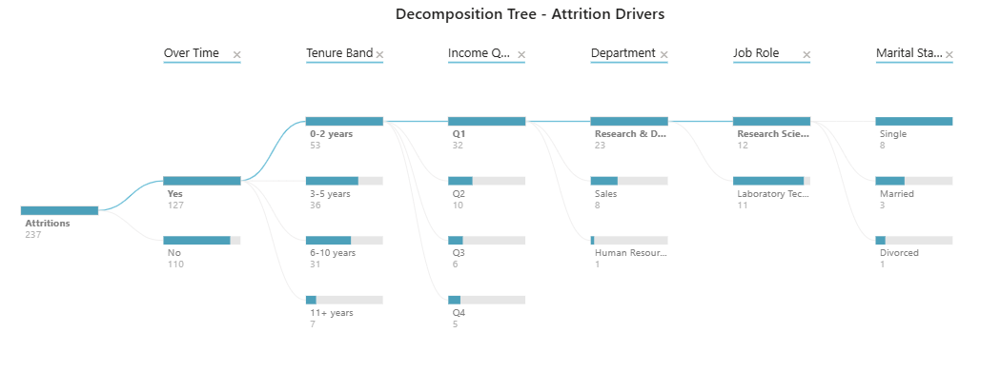
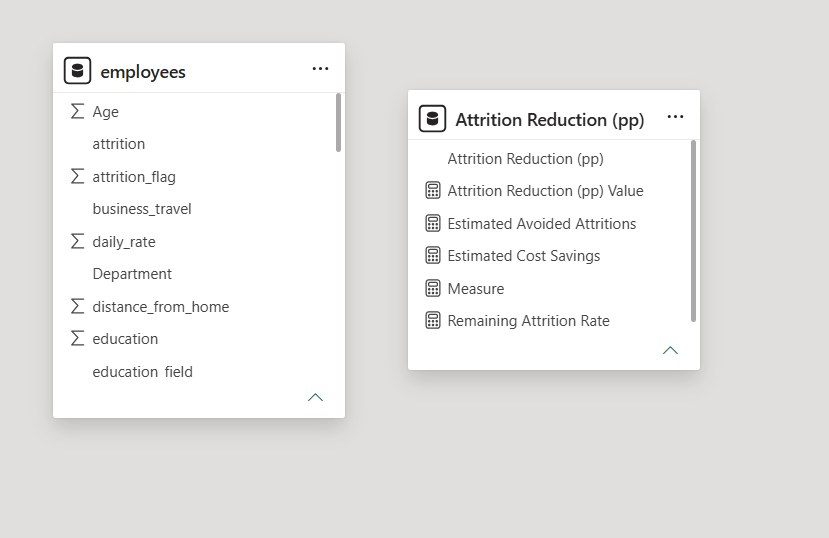
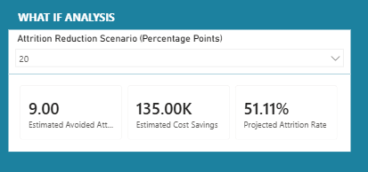

# HR Attrition Analytics

  <strong>Employee Workforce Analysis & Retention Insights</strong><br>
  SQL · SQLite · Power BI · DAX


---

## Project Overview

HR Attrition Analytics is a data analytics project focused on understanding employee turnover patterns using the IBM HR Analytics Employee Attrition dataset.

The project combines SQL-based analysis with interactive Power BI dashboards to explore workforce trends, identify high-risk employee segments, and evaluate hypothetical retention scenarios.

## Dashboard Preview

### 1. Executive Overview

A high-level view of workforce performance, including employee headcount, attrition rate, department comparisons, job roles, tenure, and overtime.



### 2. Segment Explorer

An interactive dashboard with filters for department, job role, overtime, income quartile, and tenure. Includes decomposition tree and What-if analysis.



### 3. Interactive Tooltip

Department-specific employee information displayed when hovering over the department chart.



### 4. Decomposition Tree

Explores attrition counts across different employee characteristics and workforce segments.



### 5. Power BI Model View

The data model used for the interactive report.



### 6. What-if Scenario Analysis

A hypothetical attrition-reduction scenario showing estimated avoided departures, potential cost savings, and projected attrition rate.



---

## Key Results

| Metric | Result |
|---|---:|
| Total Employees | 1,470 |
| Total Attritions | 237 |
| Overall Attrition Rate | 16.12% |
| Overtime Attrition Rate | 30.53% |
| Sales Department Attrition | 20.63% |
| Highest-Risk Tenure Group | 0–2 years |

### Key Insights

- Employees working overtime had a higher attrition rate than those who did not.
- Employees with 0–2 years of tenure showed the highest attrition rate.
- Sales had the highest department-level attrition rate.
- Sales Representatives had the highest attrition rate among the analyzed job roles.
- The lowest income quartile showed a higher attrition rate than the other income groups.

## Highest-Risk Employee Segment

The analysis identified a high-risk combination:

| Characteristic | Result |
|---|---:|
| Overtime | Yes |
| Tenure | 0–2 years |
| Income Quartile | Q1 |
| Employees | 45 |
| Attritions | 32 |
| Attrition Rate | 71.11% |

This segment can be prioritized for further HR investigation.

## What-if Analysis

The Power BI report includes an interactive parameter to explore hypothetical attrition reduction scenarios.

Example scenario:

- Reduction: 10 percentage points
- Estimated avoided attritions: 4.5
- Estimated cost savings: $67,500
- Projected segment attrition rate: 61.11%

*The scenario uses an assumed replacement cost of $15,000 per avoided departure. These figures are illustrative, not guaranteed outcomes.*

## Technologies Used

- **SQL:** Data querying and analytical calculations
- **SQLite:** Database management and reusable views
- **Power BI:** Interactive dashboards and visual analytics
- **DAX:** Measures, calculated columns, and What-if calculations
- **Power Query:** Data transformation and preparation
- **Python / Pandas:** Data analysis and supporting calculations

## Repository Structure

```text
hr-attrition-analytics/
│
├── dashboards/
│   ├── executive_overview.png
│   ├── segment_explorer.png
│   ├── interactive_tooltip.png
│   ├── decomposition_tree.png
│   ├── model_view.png
│   └── whatif_scenario.png
│
├── sql_views/
│   ├── sql_view_department.png
│   ├── sql_view_overtime.png
│   └── sql_view_job_role.png
│
├── employees.csv
├── hr_attrition_analytics.pbix
├── hr_analytics.db
├── queries.sql
├── summary.md
├── note.md
└── README.md
```

## SQL Views

Three reusable SQLite views were created to summarize attrition by department, overtime, and job role.

The SQL view screenshots are available in the `sql_views/` folder.

## Project Documentation

- **summary.md:** Executive summary, key findings, and recommendations.
- **note.md:** Detailed technical documentation, SQL queries, DAX formulas, methodology, and implementation details.
- **queries.sql:** Analytical SQL queries.
- **hr_analytics.db:** SQLite database.
- **hr_attrition_analytics.pbix:** Interactive Power BI report.

## Limitations

- The analysis is descriptive and does not establish causation.
- The What-if scenario is based on hypothetical assumptions.
- SQLite views were not imported into the Power BI model.
- DirectQuery was not implemented; Power BI uses CSV import.
- No predictive machine-learning model was developed.

---

**Author:** Ayşe Kerimova

**Project:** HR Attrition Analytics

